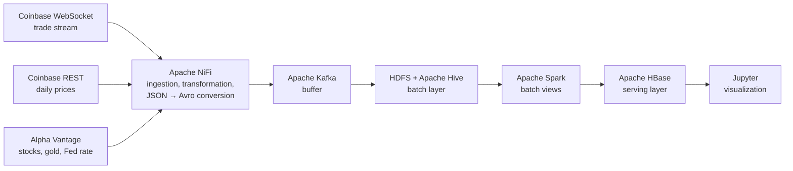

# Cryptocurrencies and Traditional Markets 

## Description of goals and benefit

Creating a system for analyzing cryptocurrency trades in the context of traditional asset prices and trends, answering the question: *how do cryptocurrency prices, volatility and trading activity relate to traditional market conditions?* The system will ingest a real-time stream of cryptocurrency trades and enrich it with traditional market data collected in batches, storing both in a batch layer and generating analytical views based on the accumulated data. It will collect and process large amounts of data, which is crucial for market data analysis, as it allows for capturing the long-term trends originating from millions of individual transactions; the sheer velocity of transactions being made on international markets at any given moment makes this problem one for which big data systems are a necessary solution. Thus, the main benefit of the system is giving quick access to ready-made results without recalculating the data.

### Potential use cases

- showing whether cryptocurrencies rise and fall together with the stock market and gold, or follow their own path,
- showing how much more volatile (thus, riskier) cryptocurrencies are compared to traditional investments,
- showing how cryptocurrency trades shift when the US Federal Reserve changes interest rates. 

## Description of datasets

### Sources and volume

Two sources: **Coinbase** (cryptocurrencies BTC and ETH; <https://docs.cdp.coinbase.com/exchange>) and **Alpha Vantage** (traditional markets; <https://www.alphavantage.co/documentation/>). These two sources differ mainly in how the data arrives. Trades come as a continuous stream of small JSON messages, several hundred thousand per day, while prices and the interest rate are downloaded in batches. The batch data covers the period from 2017-01-01, whereas the trade stream has no history and is collected only from the moment the system is started, so trade-level analyses (hourly statistics) cover only the period in which the system is running. [Table](#tbl-datasets) summarizes all four datasets.

| Dataset | Source | Type | Format | Refresh | Estimated Volume |
|---|---|---|---|---|---|
| Cryptocurrency trades | Coinbase WebSocket (`matches`) | stream | JSON | continuous | 400 000 - 700 000 records (both assets combined, per day) |
| Cryptocurrency daily prices | Coinbase REST (`candles`) | batch | JSON | one-off backfill + daily | 3500 records (per asset) |
| Stock and gold prices (QQQ, SPY, GLD) | Alpha Vantage (`TIME_SERIES_WEEKLY`, `TIME_SERIES_DAILY`) | batch | JSON | weekly history one-off, then daily | 600 records (per asset) |
| Fed interest rate | Alpha Vantage (`FEDERAL_FUNDS_RATE`) | batch | JSON | daily | 3500 records |

<!-- Table: Datasets used in the project. {#tbl-datasets} -->

### Attributes

Each dataset has a fixed set of attributes, described below together with example values taken from API responses.

The most detailed dataset is the trade stream, in which every record describes a single trade executed on Coinbase ([Table](#tbl-trades)). It is the only dataset available at the level of single trades, so it is the basis for the hourly statistics and for measuring trading activity.

| Attribute | Type | Description | Example |
|---|---|---|---|
| `trade_id` | integer | trade identifier, unique within a pair | `1121905539` |
| `product_id` | string | trading pair | `BTC-USD` |
| `price` | decimal | trade price in USD | `68879.56` |
| `size` | decimal | traded amount in BTC / ETH | `0.00071857` |
| `side` | string | side of the order waiting in the order book: `sell` means the trade was initiated by a buyer, `buy` means it was initiated by a seller | `sell` |
| `sequence` | integer | message sequence number, used to detect gaps and duplicates | `139314503178` |
| `time` | timestamp (UTC) | trade time, microsecond precision | `2026-11-13T17:59:48.591157Z` |

<!-- Table: Attributes of crypto trades. {#tbl-trades} -->

Daily prices summarize all trades of one pair in a single day as a so called candle: the opening, highest, lowest and closing price, together with the traded volume ([Table](#tbl-crypto-daily)).

| Attribute | Type | Description | Example |
|---|---|---|---|
| `product_id` | string | trading pair (added during ingestion) | `BTC-USD` |
| `time` | integer (Unix time, UTC) | start of the day | `1483228800` (2017-01-01) |
| `low` | decimal | lowest price of the day in USD | `964.37` |
| `high` | decimal | highest price of the day in USD | `1000.00` |
| `open` | decimal | first price of the day in USD | `973.37` |
| `close` | decimal | last price of the day in USD | `992.95` |
| `volume` | decimal | traded amount in BTC / ETH | `4421.50` |

<!-- Table: Attributes of crypto daily prices. {#tbl-crypto-daily} -->

Stock and gold prices have the same structure, but they describe exchange-traded funds ([Table](#tbl-market)). They are the traditional market benchmarks against which the behavior of cryptocurrencies is compared.

| Attribute | Type | Description | Example |
|---|---|---|---|
| `symbol` | string | exchange-traded fund: `QQQ` (Nasdaq-100 index), `SPY` (S&P 500 index), `GLD` (gold price) | `SPY` |
| `date` | date (New York time) | trading day; for weekly data, the last trading day of the week | `2026-11-12` |
| `open` | decimal | opening price in USD | `753.98` |
| `high` | decimal | highest price in USD | `763.04` |
| `low` | decimal | lowest price in USD | `753.67` |
| `close` | decimal | closing price in USD | `757.12` |
| `volume` | integer | number of shares traded | `37460594` |

<!-- Table: Attributes of stock and gold prices. {#tbl-market} -->

The simplest dataset is the effective federal funds rate, with one value per day ([Table](#tbl-fed)). The rate changes rarely, but every change affects all markets at once, which makes it a natural reference point for comparing how cryptocurrencies and traditional assets react to the same event.

| Attribute | Type | Description | Example |
|---|---|---|---|
| `date` | date | day | `2026-11-11` |
| `value` | decimal | effective federal funds rate, % per year | `3.88` |

<!-- Table: Attributes of the Fed interest rate. {#tbl-fed} -->

### Joining the datasets and API limits

The datasets are joined by date. Coinbase reports time in UTC and Alpha Vantage in New York time, so both are unified to a common date during processing. Days without a stock market session, such as weekends and holidays, are filled with the last known value. Coinbase requires no API key, while Alpha Vantage requires a free API key and allows 25 requests per day. Free daily stock prices cover only the last 100 days, which is why the stock history in [Table](#tbl-datasets) is based on weekly prices.

### Storage strategy

On its way through the system the data passes four storage layers, each with a different role ([Table](#tbl-storage)). Kafka holds incoming records only for a short time, the raw zone in HDFS keeps an unchanged copy of everything that was received, the batch layer contains cleaned data ready for analysis, and HBase serves the final results. Because each layer is built from the previous one, any of them can be recreated when a processing step changes.

| Layer | Technology | Format / structure | Purpose |
|---|---|---|---|
| Buffer | Apache Kafka | topics: `crypto_trades`, `crypto_prices`, `market_data`, `dlq` | trades keep arriving while HDFS writes are slow or restarted; `dlq` (dead letter queue) keeps invalid records, e.g. an Alpha Vantage limit message instead of data, for later inspection |
| Raw data | HDFS | Avro, `/data/raw/<source>/<yyyy-mm-dd>/` | the batch layer can be rebuilt after a processing bug, because live trades cannot be fetched again and the Alpha Vantage request limit makes reloading the history slow; Avro (row-based) fits records written one by one |
| Batch layer | HDFS + Apache Hive | Parquet; `trades` (partitioned by pair, day), `crypto_daily`, `market_weekly`, `market_daily`, `fed_rate` | Spark jobs read only the needed columns (e.g. `price`, `size`, `time`) of millions of trades and skip partitions of other pairs and days |
| Serving layer | Apache HBase | `daily_view` (key `yyyymmdd`), `correlations` (key `pair#asset#window#date`), `hourly_stats` (key `pair#yyyymmddhh`) | the notebook reads ready results for a given day, pair or hour without running Spark |

<!-- Table: Storage layers. {#tbl-storage} -->

## Description of the planned architecture

### Overview

The system follows the batch and serving layers of the Lambda architecture ([Figure](#fig-architecture)). Data from the three sources is collected by NiFi, buffered in Kafka and stored in HDFS and Hive. Spark then turns the stored data into batch views, which are written to HBase and visualized in Jupyter notebooks.

<!-- Figure: Planned architecture of the system. {#fig-architecture} -->

### Technologies

Each technology in this chain has a clearly separated responsibility ([Table](#tbl-technologies)). NiFi is the only component that communicates with the external APIs, Spark is the only one that transforms the data after it has been stored, and the remaining tools buffer, store or serve the data. The whole system runs locally in Docker Compose. Every component (NiFi flows, Kafka topics, Spark jobs, Hive and HBase tables) will be covered by functional tests describing the goal, the steps, the expected result and the confirmation of the result (log or screenshot).

| Technology | Role |
|---|---|
| Apache NiFi | WebSocket stream ingestion, scheduled REST requests (Alpha Vantage limit control), JSON flattening, time zone unification, validation, Avro conversion, routing invalid records to `dlq`; moving data from Kafka to the raw zone in HDFS |
| Apache Kafka | buffering of streaming and batch data between ingestion and writing to HDFS |
| HDFS + Apache Hive | HDFS stores raw data (Avro files in directories per source and day) and cleaned data; Hive defines partitioned tables only over the cleaned Parquet data |
| Apache Spark | conversion of raw Avro data into cleaned Parquet tables; aggregation of trades into hourly and daily statistics, joining by date, rolling correlations, volatility; writing batch views to HBase |
| Apache HBase | serving batch views with random reads by key |
| Jupyter | visualization of the batch views read from HBase |
| Docker Compose | local runtime environment |

<!-- Table: Technologies and their roles. {#tbl-technologies} -->
