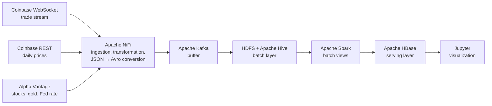

# Cryptocurrencies and Traditional Markets 

## Description of goals and benefit

Creating a system for analyzing cryptocurrency trades in the context of traditional asset prices and trends, answering the question: *how do cryptocurrency prices, volatility and trading activity relate to traditional market conditions?* The system will ingest a real-time stream of cryptocurrency trades and enrich it with traditional market data collected in batches, storing both in a batch layer and generating analytical views based on the accumulated data. It will collect and process large amounts of data, which is crucial for market data analysis, as it allows for capturing the long-term trends originating from millions of individual transactions; the sheer velocity of transactions being made on international markets at any given moment makes this problem one for which big data systems are a necessary solution. Thus, the main benefit of the system is giving quick access to ready-made results without recalculating the data.

**Potential use cases:**
- Showing whether cryptocurrencies rise and fall together with the stock market and gold, or follow their own path,
- showing how much more volatile (thus, riskier) cryptocurrencies are compared to traditional investments,
- showing how cryptocurrency trades shift when the US Federal Reserve changes interest rates. 

## Description of datasets (volume, type, store and refresh strategy)

Two sources: **Coinbase** (cryptocurrencies BTC and ETH) and **Alpha Vantage** (traditional markets). Common analysis period: **from 2017-01-01**.

| Dataset | Source | Type | Format | Refresh | Estimated Volume |
|---|---|---|---|---|---|
| Cryptocurrency trades | Coinbase WebSocket (`matches`) | stream | JSON | continuous | 400 000 - 700 000 records (both assets combined, per day) |
| Cryptocurrency daily prices | Coinbase REST (`candles`) | batch | JSON | one-off backfill + daily | 3500 records (per asset) |
| Stock and gold prices (QQQ, SPY, GLD) | Alpha Vantage (`TIME_SERIES_WEEKLY`, `TIME_SERIES_DAILY`) | batch | JSON | weekly history one-off, then daily | 600 records (per asset) |
| Fed interest rate | Alpha Vantage (`FEDERAL_FUNDS_RATE`) | batch | JSON | daily | 3500 records |

**Attributes**

*Crypto trades* – one record per executed trade:

| Attribute | Type | Description | Example |
|---|---|---|---|
| `trade_id` | integer | trade identifier, unique within a pair | `1121905539` |
| `product_id` | string | trading pair | `BTC-USD` |
| `price` | decimal | trade price in USD | `68879.56` |
| `size` | decimal | traded amount in BTC / ETH | `0.00071857` |
| `side` | string | side of the order waiting in the order book: `sell` – the trade was initiated by a buyer, `buy` – by a seller | `sell` |
| `sequence` | integer | message sequence number, used to detect gaps and duplicates | `139314503178` |
| `time` | timestamp (UTC) | trade time, microsecond precision | `2026-11-13T17:59:48.591157Z` |

*Crypto daily prices* – one record per pair per day:

| Attribute | Type | Description | Example |
|---|---|---|---|
| `product_id` | string | trading pair (added during ingestion) | `BTC-USD` |
| `time` | integer (Unix time, UTC) | start of the day | `1451606400` (2016-01-01) |
| `low` | decimal | lowest price of the day in USD | `427.92` |
| `high` | decimal | highest price of the day in USD | `437.15` |
| `open` | decimal | first price of the day in USD | `430.35` |
| `close` | decimal | last price of the day in USD | `435.66` |
| `volume` | decimal | traded amount in BTC / ETH | `3863.28` |

*Stock and gold prices* – one record per symbol per trading day (daily) or week (weekly):

| Attribute | Type | Description | Example |
|---|---|---|---|
| `symbol` | string | exchange-traded fund: `QQQ` – Nasdaq-100 index, `SPY` – S&P 500 index, `GLD` – gold price | `SPY` |
| `date` | date (New York time) | trading day; for weekly data – last trading day of the week | `2026-11-12` |
| `open` | decimal | opening price in USD | `753.98` |
| `high` | decimal | highest price in USD | `763.04` |
| `low` | decimal | lowest price in USD | `753.67` |
| `close` | decimal | closing price in USD | `757.12` |
| `volume` | integer | number of shares traded | `37460594` |

*Fed interest rate* – one record per day:

| Attribute | Type | Description | Example |
|---|---|---|---|
| `date` | date | day | `2026-11-11` |
| `value` | decimal | effective federal funds rate, % per year | `3.88` |

All numeric values arrive as text in JSON and are converted to numbers during ingestion.

**Join key:** date (Coinbase in UTC, Alpha Vantage in New York time; unified during processing). Days without a stock market session are filled with the last known value.

**Limits:** Coinbase – no API key required; Alpha Vantage – free API key, 25 requests / day (the project uses ~5). Free daily stock prices cover only the last 100 days, so the history is loaded from weekly prices.

**Storage:**

| Layer | Technology | Format / structure | Purpose |
|---|---|---|---|
| Buffer | Apache Kafka | topics: `crypto_trades`, `crypto_prices`, `market_data`, `dlq` | absorbs the stream so that no data is lost when downstream components are slow or restarted; `dlq` (dead letter queue) collects records that failed validation, e.g. malformed JSON or an API limit message instead of data, so they do not stop the flow and can be inspected later |
| Raw data | HDFS | Avro, `/data/raw/<source>/<yyyy-mm-dd>/` | unchanged copy of the ingested data, allowing reprocessing; Avro is a row-based format with an embedded schema, suited for writing records one by one as they arrive |
| Batch layer | HDFS + Apache Hive | Parquet; `trades` (partitioned by pair, day), `crypto_daily`, `market_weekly`, `market_daily`, `fed_rate` | cleaned data for analysis; HDFS stores the files, Hive defines tables on top of them (schema, partitions) and enables SQL queries; Parquet is a compressed column-based format, suited for analytical queries that read only selected columns |
| Serving layer | Apache HBase | `daily_view` (key `yyyymmdd`), `correlations` (key `pair#asset#window#date`), `hourly_stats` (key `pair#yyyymmddhh`) | precomputed results available with fast reads by key |

## Description of the planned architecture (diagram, techologies, use-cases)

| Technology | Role |
|---|---|
| Apache NiFi | WebSocket stream ingestion, scheduled REST requests (Alpha Vantage limit control), JSON flattening, time zone unification, validation, Avro conversion, routing invalid records to `dlq` |
| Apache Kafka | buffering of streaming and batch data before writing to HDFS |
| HDFS + Apache Hive | storage of raw (Avro) and cleaned (Parquet) data in partitioned tables |
| Apache Spark | aggregation of trades into hourly and daily statistics, joining by date, rolling correlations, volatility |
| Apache HBase | serving batch views with random reads by key |
| Docker Compose | local runtime environment |
